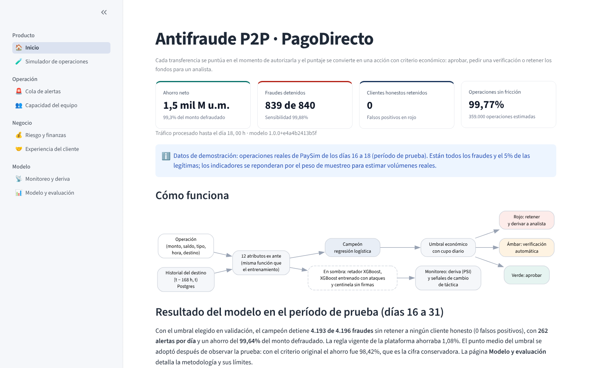
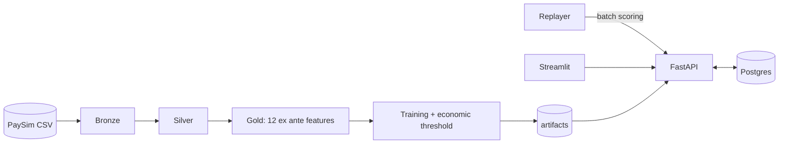

# P2P Transfer Fraud Detection

[](https://github.com/silvanoruatabelen1/fraud-detection-p2p/actions/workflows/ci.yml)


[](LICENSE)

**[Versión en español](README.md)**

An end-to-end system that decides, at authorization time, whether to approve a mobile-wallet transfer, ask for step-up verification, or hold the funds for an analyst. It combines an explainable model with a cost-based decision threshold, a stateless API that computes a causal 168-hour destination history from the database, and a web platform for Operations, Risk, HR and Marketing. One command brings it all up.



## Results

Evaluated on a held-out later period: PaySim days 16–31, with 505,511 at-risk transactions and 4,196 frauds. A daily review capacity of 1,000 alerts is assumed, served in arrival order.

| Strategy | Frauds stopped | Honest customers held | Alerts per day | Net savings |
|---|---|---|---|---|
| Platform's existing rule (`isFlaggedFraud`) | 13 of 4,196 | 0 | 0.8 | 1.08% |
| **Champion: logistic regression** | **4,193 of 4,196** | **0** | **262.1** | **99.64%** |
| Champion with the original threshold rule | 4,184 of 4,196 | 0 | 261.5 | 98.42% |
| Shadow challenger: XGBoost | 4,193 of 4,196 | 0 | 262.1 | 99.64% |

- **Champion metrics:** recall 99.93% (95% Wilson CI: 99.79% to 99.98%) and PR-AUC 0.99951.
- **The 99.64% savings figure is retrospective.** The midpoint threshold rule was adopted after looking at the test period. The original rule gives 98.42%, which is the conservative figure.

**The caveat that matters.** In PaySim, a two-signature rule matches the model, because the simulator programs fraudsters to empty the account. If an attacker leaves even one cent behind, the champion catches 0.3% of frauds. That is why the system runs shadow models that never affect the decision: an XGBoost trained on synthetic partial withdrawals and a sentinel without the exact signatures. Their disagreements with the champion are monitored as a tactic-change signal. See the [model card](docs/model_card.md).

## What a senior reviewer may want to check

| Check | What to look for |
|---|---|
| **Training–serving parity** | One feature function is shared by training, attack simulation and the API. A test replays 18,748 real transactions through the API, which rebuilds the 168-hour history from SQL. It must reproduce the offline score within 1e-9, on both SQLite and Postgres. |
| **No leakage** | Only *ex ante* features are used. The history window is `[t − 168 h, t)`, verified by brute force in the tests. The split is chronological: days 1–12 to train, 13–15 to validate, 16–31 to test. |
| **Decision economics** | The threshold maximizes net savings under a review capacity enforced on every day, not on average. A what-if endpoint re-selects the threshold when costs or capacity change. |
| **Monitoring** | PSI per feature on full-day windows, weighted by sampling weight, plus daily alerts from the shadow models. |
| **Engineering** | `uv` lockfile, multi-stage Docker images (non-root, healthchecks), docker compose with Postgres, and GitHub Actions running lint, tests on SQLite and Postgres, image builds and a compose smoke test. |

## Quick start

```bash
git clone https://github.com/silvanoruatabelen1/fraud-detection-p2p.git
cd fraud-detection-p2p
docker compose up --build
```

Once it is up:

- **App:** http://localhost:8501
- **Interactive API docs:** http://localhost:8000/docs

No dataset download is needed: the images ship the trained models and a demo set of real test-period traffic. To reproduce everything from raw data, run `make data && make pipeline`; you need a Kaggle token.

## Architecture



## Credits

The analysis started as the capstone project of the *Diploma in Data Science, AI and Business Applications* (FCE & FaMAF, Universidad Nacional de Córdoba, 2026), by Group 21: María Belén Silvano Ruata, Hector Eduardo Perez and Facundo Villena. The productization was built by María Belén Silvano Ruata: package, API, platform, containers and CI.

**Data:** Lopez-Rojas, Elmir & Axelsson (2016), *PaySim: A financial mobile money simulator for fraud detection*. The research notebooks are in Spanish.
