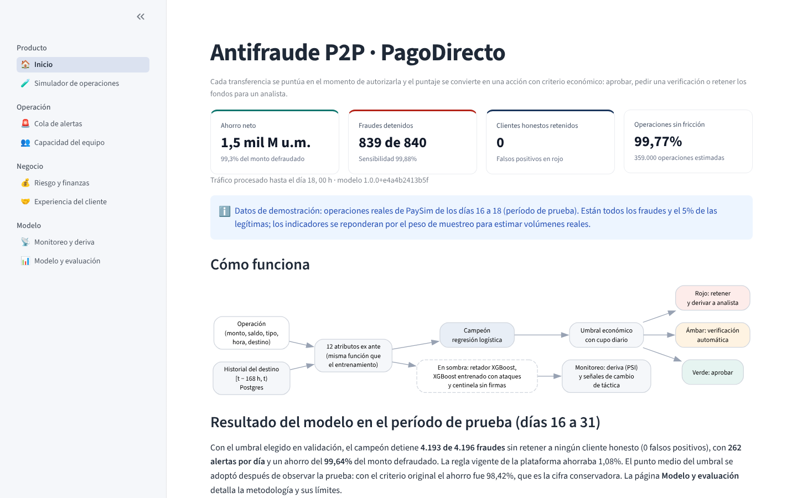
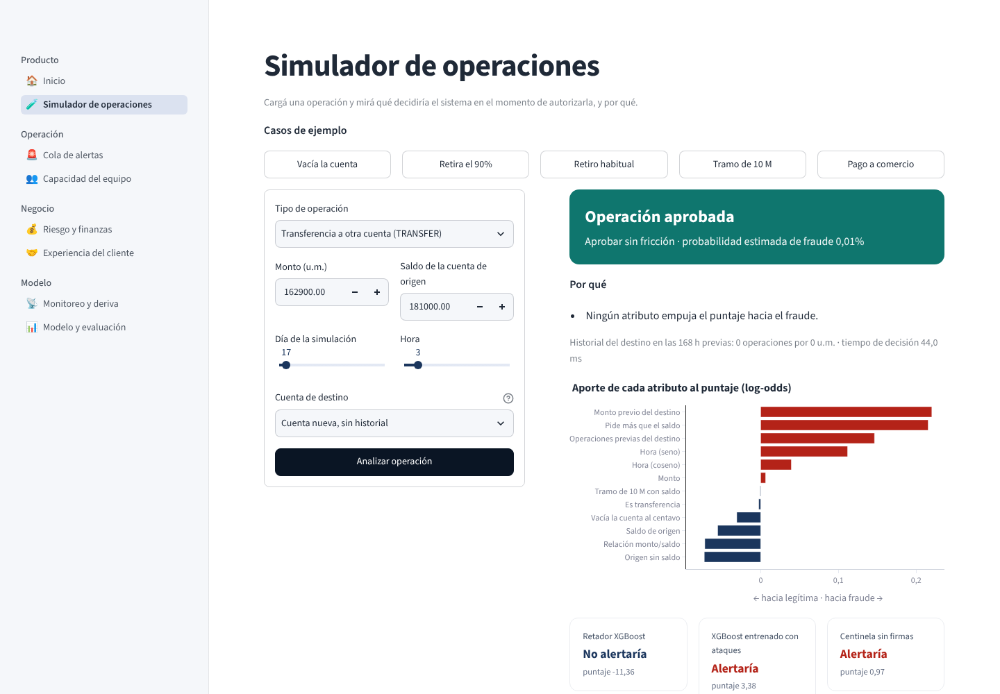
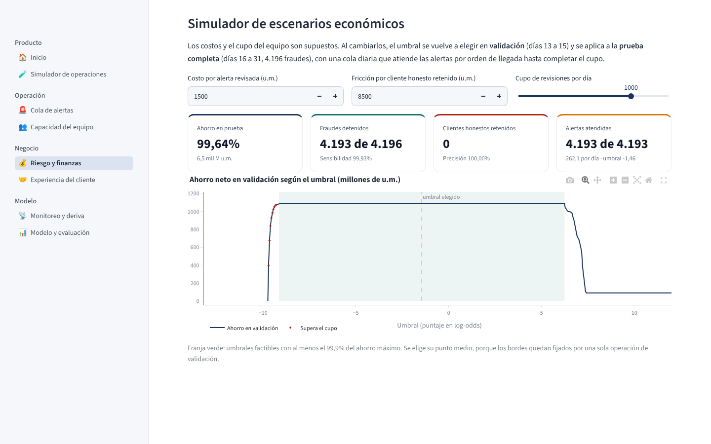
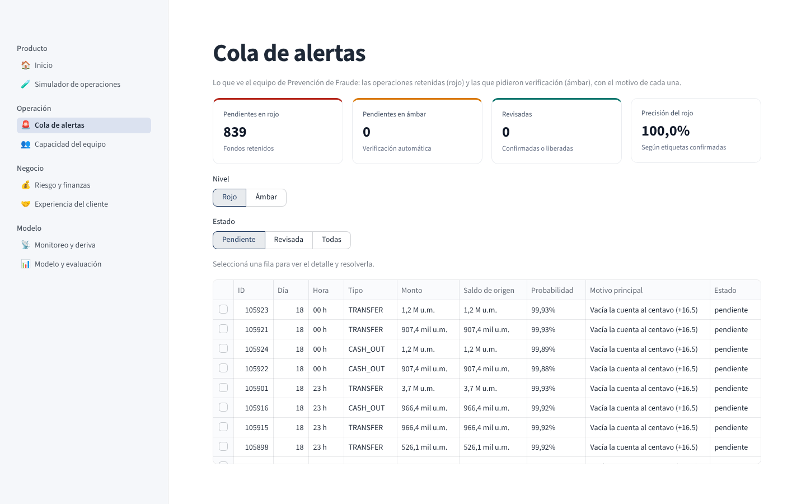
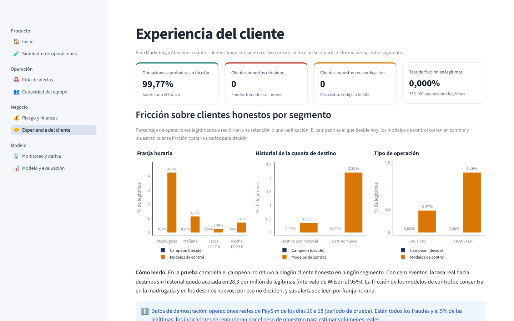
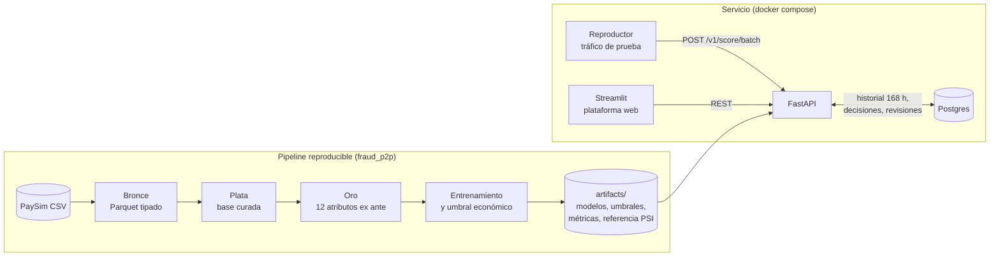

# Detección de fraude en transferencias P2P

[](https://github.com/silvanoruatabelen1/FraudDetection/actions/workflows/ci.yml)


[](LICENSE)

**[English version](README.en.md)**

Sistema de punta a punta que decide, en el momento de autorizar una transferencia, si aprobarla, pedir una verificación o retener los fondos para un analista. Combina un modelo explicable con un umbral elegido por su resultado económico, una API con historial causal calculado desde la base de datos y una plataforma web para Operaciones, Riesgo, Recursos Humanos y Marketing. Todo se levanta con un solo comando.



## Resultados

Evaluación en un período posterior al de entrenamiento y validación: días 16 a 31 de PaySim, con 505.511 operaciones de riesgo y 4.196 fraudes. Se asume un cupo de 1.000 revisiones diarias, atendidas por orden de llegada.

| Estrategia | Fraudes detenidos | Clientes honestos retenidos | Alertas por día | Ahorro neto |
|---|---|---|---|---|
| Regla vigente de la plataforma (`isFlaggedFraud`) | 13 de 4.196 | 0 | 0,8 | 1,08% |
| **Campeón: regresión logística** | **4.193 de 4.196** | **0** | **262,1** | **99,64%** |
| Campeón con el criterio de umbral original | 4.184 de 4.196 | 0 | 261,5 | 98,42% |
| Retador en sombra: XGBoost | 4.193 de 4.196 | 0 | 262,1 | 99,64% |

- **Métricas del campeón:** sensibilidad 99,93% (IC 95% de Wilson: 99,79% a 99,98%), PR-AUC 0,99951, latencia de decisión del orden de milisegundos con persistencia incluida.
- **El ahorro de 99,64% es retrospectivo.** El criterio del punto medio del umbral se adoptó después de observar la prueba. Con el criterio original el ahorro fue 98,42%, que es la cifra conservadora.

### Lectura crítica

Este no es un caso de éxito sin matices. En PaySim una regla de dos firmas exactas iguala al modelo, porque el simulador programa al atacante para que vacíe la cuenta. Si el atacante deja aunque sea un centavo, el campeón detecta el 0,3% de los fraudes. Por eso el sistema corre en paralelo, sin efecto sobre la decisión, un XGBoost entrenado con ataques sintéticos y un centinela sin firmas, y monitorea sus desacuerdos con el campeón como señal de que el atacante cambió de táctica. Los detalles están en el [model card](docs/model_card.md).

## La plataforma

| Simulador de operaciones | Riesgo y finanzas: escenarios económicos |
|---|---|
|  |  |
| **Cola de alertas** | **Experiencia del cliente** |
|  |  |

| Página | Para quién | Qué muestra |
|---|---|---|
| Simulador | Cualquiera | Carga una operación de cualquiera de los cinco tipos. Devuelve el veredicto, los motivos, el aporte de cada atributo y la opinión de los modelos en sombra. |
| Cola de alertas | Prevención de fraude | Operaciones retenidas y verificaciones, con el detalle de cada caso y la resolución del analista (confirmar fraude o liberar). |
| Capacidad del equipo | Recursos Humanos | Alertas por día y por hora frente al cupo, y cuántos analistas hacen falta por turno. |
| Riesgo y finanzas | Dirección y Finanzas | Monto protegido, costo de operar y ahorro neto. Incluye un simulador que vuelve a elegir el umbral si cambian los costos o el cupo. |
| Experiencia del cliente | Marketing y Atención | Fricción sobre clientes honestos por franja horaria, historial del destino y tipo de operación. |
| Monitoreo y deriva | Ciencia de datos | Índice de estabilidad poblacional (PSI) por atributo y alertas diarias de cada modelo de control. |
| Modelo y evaluación | Auditoría | Resultados en prueba, metodología, hiperparámetros y límites. |

## Arquitectura



| Decisión | Por qué |
|---|---|
| **Una sola función de atributos** para entrenar, evaluar, simular ataques y servir. | Evita que el modelo vea en producción algo distinto de lo que vio al entrenar. Un test lo verifica: la API reproduce el puntaje del entrenamiento con una diferencia menor a 1e-9 en las 18.748 operaciones de demostración, tanto en SQLite como en Postgres. |
| **El historial causal de 168 h se calcula desde la base**, con la ventana [t − 168 h, t). | La API no guarda estado en memoria y puede escalar horizontalmente. |
| **Umbral económico con cupo diario.** | Un umbral es factible solo si ningún día supera la capacidad de revisión. En la evaluación, una cola diaria atiende las alertas por orden de llegada. |
| **Modelos en sombra.** | El retador, el retador entrenado con ataques y el centinela puntúan sin decidir. Sus alertas sobre operaciones que el campeón aprobó son la señal para reentrenar. |

Las decisiones de diseño están documentadas en [`docs/decisiones/`](docs/decisiones).

## Inicio rápido

Con Docker no hace falta descargar el dataset: la imagen incluye los modelos entrenados y un conjunto de demostración con tráfico real del período de prueba.

```bash
git clone https://github.com/silvanoruatabelen1/FraudDetection.git
cd FraudDetection
docker compose up --build
```

Al levantar el sistema quedan disponibles:

- **Aplicación:** http://localhost:8501
- **Documentación interactiva de la API:** http://localhost:8000/docs

El servicio `replayer` envía el tráfico de los días 16 a 18 hora por hora, y los paneles se actualizan a medida que llega. Para borrar los datos operativos, corré `docker compose down -v`.

### Desarrollo local

```bash
make setup      # entorno con uv y hooks de pre-commit
make test       # tests (atributos, causalidad, umbral, puntuación, API y paridad)
make api        # API en http://localhost:8000 con SQLite
make app        # aplicación en http://localhost:8501
make replay     # reproduce el tráfico de demostración contra la API local
```

### Reproducir desde los datos crudos

```bash
make data       # descarga PaySim desde Kaggle (requiere token en ~/.kaggle/kaggle.json)
make pipeline   # bronce -> plata -> oro -> modelos, umbrales, métricas y datos de demo (~3 min)
```

El pipeline reproduce los umbrales y las métricas de la investigación con precisión completa.

## Estructura

```
├── src/fraud_p2p/     paquete: datos, atributos, umbral económico, entrenamiento, puntuación y monitoreo
├── api/               FastAPI: puntuación, cola de alertas, KPI, monitoreo y escenarios económicos
├── app/               plataforma web en Streamlit (una página por público)
├── replayer/          reproductor del tráfico de prueba
├── artifacts/         modelos entrenados, umbrales, métricas y referencia de deriva
├── data/demo/         tráfico de demostración e historial exacto de 168 h (~3 MB)
├── notebooks/         investigación: NB1 encuadre, EDA y curación · NB2 modelado, umbral y evaluación
├── reports/           figuras y tablas de la investigación
├── docs/              model card, data card, decisiones de diseño e informe técnico
├── docker/            Dockerfiles multi-etapa
└── tests/             pytest
```

## Metodología en breve

1. **Encuadre de negocio.** El fraude típico es la toma de cuenta: el atacante transfiere el saldo y lo retira en efectivo. Los costos de revisar y de retener a un cliente honesto son supuestos declarados: 1.500 y 8.500 unidades monetarias (u.m.).
2. **Exploración y curación.** No hay nulos ni duplicados. Los montos se leen en `float64`, porque en `float32` cambia el centavo del 20,5% de ellos. Todo el fraude ocurre en TRANSFER y CASH_OUT, y el 97,82% de los fraudes transfiere exactamente el saldo.
3. **Atributos ex ante.** Solo información disponible al autorizar: se excluyen los saldos posteriores, que filtran la etiqueta. El historial causal se verificó por fuerza bruta.
4. **Selección de modelo.**
   - Se usó una partición cronológica: días 1 a 12 para entrenar, 13 a 15 para validar y 16 a 31 para la prueba.
   - Se compararon seis familias con validación cruzada de origen móvil y PR-AUC.
   - Las seis quedaron dentro de un error estándar (0,99783 a 0,99805), así que gana la más simple.
5. **Umbral económico.** Es el punto medio de la franja factible con al menos el 99,9% del ahorro máximo de validación.
6. **Robustez.**
   - Ablación de atributos.
   - Batería de 18 ataques.
   - Entrenamiento con retiros parciales sintéticos.
   - Control de madrugada.
   - Equidad por segmento.

El análisis completo está en los [notebooks](notebooks) y en el [informe técnico](docs/informe_tecnico.pdf).

## Créditos

El análisis y el modelado nacieron como Actividad Integradora Final de la **Diplomatura en Ciencia de Datos, Inteligencia Artificial y sus Aplicaciones en Economía y Negocios** (FCE y FaMAF, Universidad Nacional de Córdoba, 2026), desarrollada por el Grupo 21: María Belén Silvano Ruata, Hector Eduardo Perez y Facundo Villena. La extensión a producto la desarrolló María Belén Silvano Ruata: paquete, API, plataforma, contenedores e integración continua.

**Datos:** E. A. Lopez-Rojas, A. Elmir y S. Axelsson (2016). *PaySim: A financial mobile money simulator for fraud detection.* 28th European Modeling and Simulation Symposium. Dataset sintético publicado en Kaggle.

Licencia [MIT](LICENSE).
